# AI Demo Collection

AI 辅助生成的交互式前端作品合集，包含三维场景、数字孪生、机械展示和网页小游戏。每个项目独立运行，并提供源码、运行说明与生成提示词。

[在线浏览全部项目](https://fanhuayishiy.github.io/ai-demo/) · [本地运行](#本地运行) · [新增项目](#新增项目) · [维护文档](./docs/maintaining.md)

各项目 README 的 **主生成提示（原文）** 保留可核验的原始请求；无法核验的历史原文会明确说明，整理后的复现提示词另行标注。

## 项目列表

点击截图可查看大图，通过“在线”链接进入项目；所有缩略图均来自项目实际运行画面或项目内渲染资源，统一为 16:9 静态 WebP。

| 截图 | 项目 | 一句话简介 | 预览 | 详细文档 |
| --- | --- | --- | --- | --- |
| <a href="./assets/project-thumbnails/habitat-interactive-home.webp">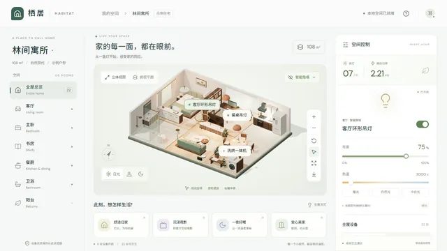</a> | habitat-interactive-home | 栖居 HABITAT 可探索家庭 3D 模型，多灯独立控制、家电交互与智能隐墙 | [在线](https://fanhuayishiy.github.io/ai-demo/habitat-interactive-home/dist/) | [README](./habitat-interactive-home/README.md) |
| <a href="./assets/project-thumbnails/orbit-heatpump-washer-dryer.webp">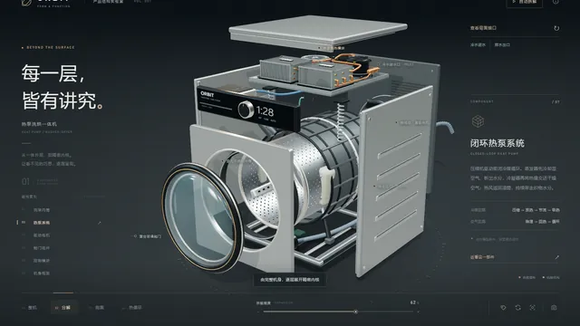</a> | orbit-heatpump-washer-dryer | ORBIT 热泵洗烘一体机，3D 爆炸拆解、热循环与进排水结构交互 | [在线](https://fanhuayishiy.github.io/ai-demo/orbit-heatpump-washer-dryer/dist/) | [README](./orbit-heatpump-washer-dryer/README.md) |
| <a href="./assets/project-thumbnails/boeing-787-digital-twin.webp">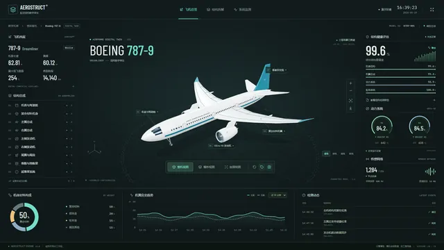</a> | boeing-787-digital-twin | AEROSTRUCT 波音 787-9 结构数字孪生大屏，3D 爆炸拆解、客舱剖视与模拟监测图表 | [在线](https://fanhuayishiy.github.io/ai-demo/boeing-787-digital-twin/dist/) | [README](./boeing-787-digital-twin/README.md) |
| <a href="./assets/project-thumbnails/sunny-side-kindergarten.webp">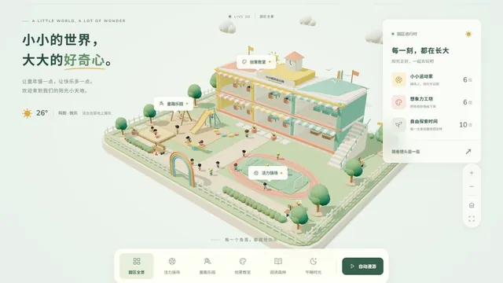</a> | sunny-side-kindergarten | 小小晴天实时 3D 幼儿园，22 名儿童与 3 名老师、六区聚焦、人物跟随及自动漫游 | [在线](https://fanhuayishiy.github.io/ai-demo/sunny-side-kindergarten/dist/) | [README](./sunny-side-kindergarten/README.md) |
| <a href="./assets/project-thumbnails/hydrogen-energy-system.webp">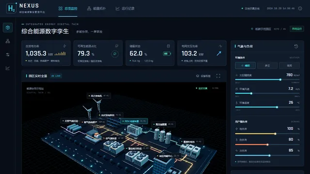</a> | hydrogen-energy-system | H₂ NEXUS 含氢综合能源数字孪生，五类能流动态可视化与守恒仿真 | [在线](https://fanhuayishiy.github.io/ai-demo/hydrogen-energy-system/) | [README](./hydrogen-energy-system/README.md) |
| <a href="./assets/project-thumbnails/campus-3d-dashboard.webp">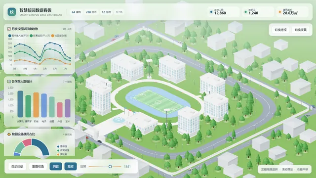</a> | campus-3d-dashboard | 智慧校园 3D 数据大屏（单 HTML 文件） | [在线](https://fanhuayishiy.github.io/ai-demo/campus-3d-dashboard/) | [README](./campus-3d-dashboard/README.md) |
| <a href="./assets/project-thumbnails/mcb-2p-c16-blender-animation.webp">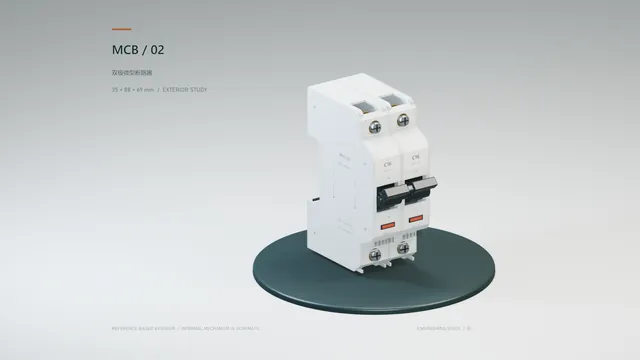</a> | mcb-2p-c16-blender-animation | 双极空气开关 Blender 精细建模与 22 秒 8 章节工程动画 | [在线](https://fanhuayishiy.github.io/ai-demo/mcb-2p-c16-blender-animation/) | [README](./mcb-2p-c16-blender-animation/README.md) |
| <a href="./assets/project-thumbnails/voxel-construction-site.webp">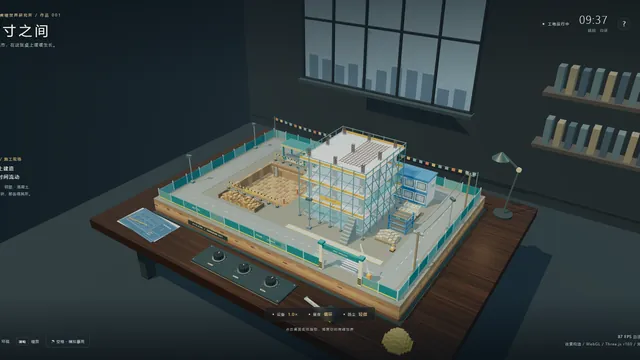</a> | voxel-construction-site | 体素微缩建筑工地沙盘「方寸之间」（Three.js r160 完全离线单 HTML） | [在线](https://fanhuayishiy.github.io/ai-demo/voxel-construction-site/preview.html) | [README](./voxel-construction-site/README.md) |
| <a href="./assets/project-thumbnails/voxel-ramen-stall.webp">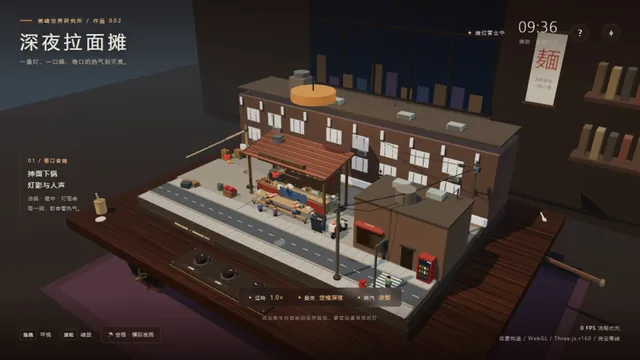</a> | voxel-ramen-stall | 体素微缩深夜拉面摊沙盘（Three.js r160 完全离线单 HTML） | [在线](https://fanhuayishiy.github.io/ai-demo/voxel-ramen-stall/preview.html) | [README](./voxel-ramen-stall/README.md) |
| <a href="./assets/project-thumbnails/sakura-station-corner.webp">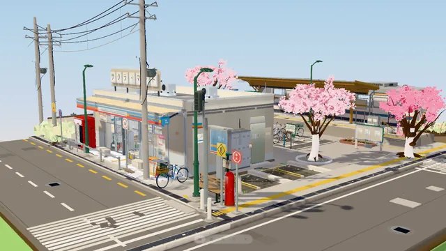</a> | sakura-station-corner | 樱花街角 · 电车与便利店微缩三维沙盘（102 个独立资产模块，五档天气，画面无文字浮层） | [在线](https://fanhuayishiy.github.io/ai-demo/sakura-station-corner/dist/) | [README](./sakura-station-corner/README.md) |
| <a href="./assets/project-thumbnails/sanfang-qixiang-atlas.webp">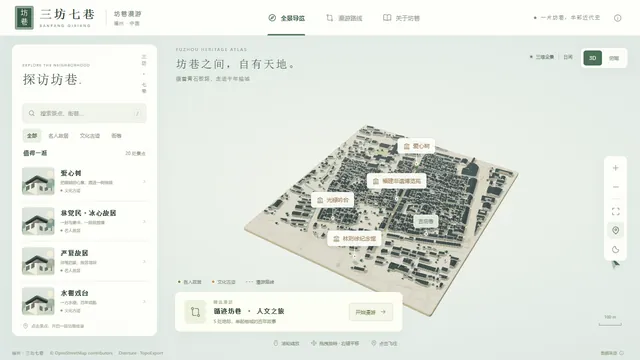</a> | sanfang-qixiang-atlas | 三坊七巷 · 坊巷漫游：基于真实地图的 3D 古城导览，支持搜索、缩放与点击飞行 | [在线](https://fanhuayishiy.github.io/ai-demo/sanfang-qixiang-atlas/dist/) | [README](./sanfang-qixiang-atlas/README.md) |
| <a href="./assets/project-thumbnails/terra-728-tractor-blender-animation.webp">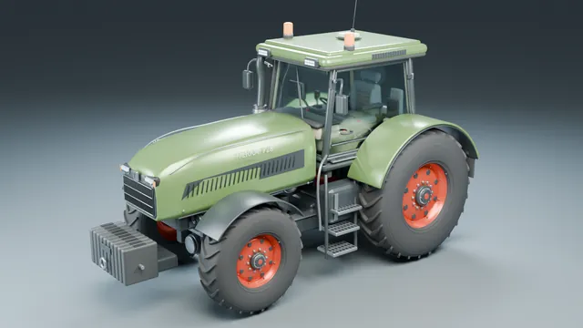</a> | terra-728-tractor-blender-animation | 现代四驱拖拉机 Blender 精细建模与 15 秒机械动画 | [在线](https://fanhuayishiy.github.io/ai-demo/terra-728-tractor-blender-animation/) | [README](./terra-728-tractor-blender-animation/README.md) |
|  | sunset-flight-study | 夕空飞行 · 奶油白单翼机穿越紫金云海，近距离按键驾驶与官方原曲配乐 | [在线](https://fanhuayishiy.github.io/ai-demo/sunset-flight-study/dist/) | [README](./sunset-flight-study/README.md) |
| <a href="./assets/project-thumbnails/warehouse-demo.webp">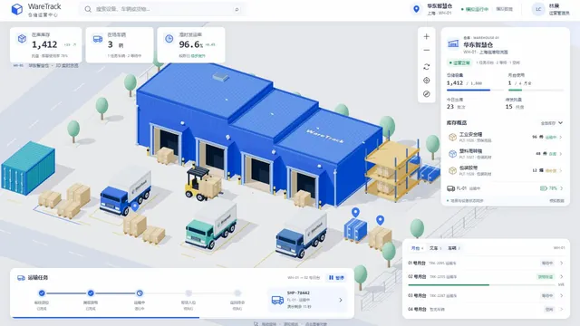</a> | warehouse-demo | WareTrack 单仓三维运营中心，叉车搬运闭环、库存任务联动、对象聚焦与镜头巡游 | [在线](https://fanhuayishiy.github.io/ai-demo/warehouse-demo/dist/client/) | [README](./warehouse-demo/README.md) |
| <a href="./assets/project-thumbnails/modular-fire-response.webp">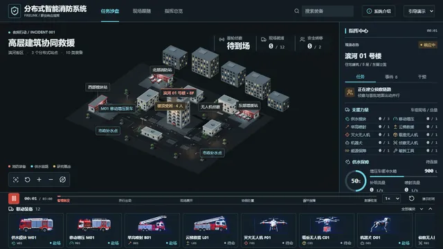</a> | modular-fire-response | FIRELINK 分布式消防概念演示，三机共用一根水带、移动增压、循环补水与无人机物资投送 | [在线](https://fanhuayishiy.github.io/ai-demo/modular-fire-response/dist/) | [README](./modular-fire-response/README.md) |
| <a href="./assets/project-thumbnails/roadster-escape-toll.webp">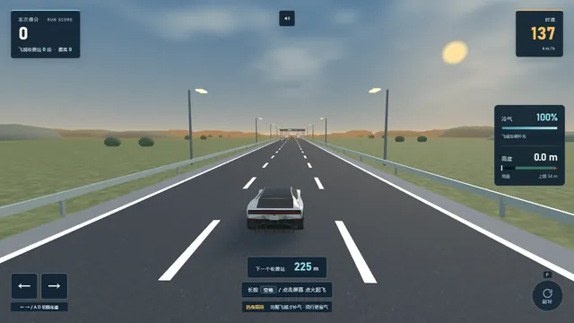</a> | roadster-escape-toll | Roadster 逃离收费站：三车道切换、空中翻滚、飞越车辆补气与缓慢提速，保留原有玩家车模 | [在线](https://fanhuayishiy.github.io/ai-demo/roadster-escape-toll/) | [README](./roadster-escape-toll/README.md) |
| <a href="./assets/project-thumbnails/ocean-shallows.webp">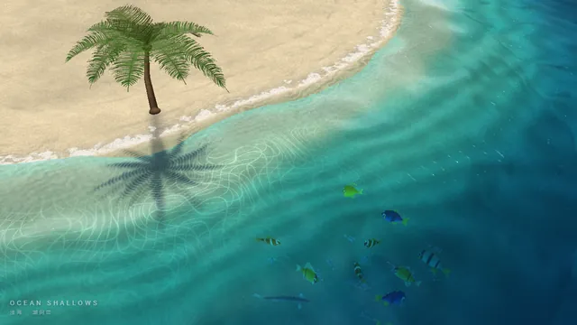</a> | ocean-shallows | 俯视视角的热带浅海：白沙沙滩、随风摇曳的棕榈树、由浅绿松石渐变到深蓝的海水，水下焦散光网与七种热带鱼，点击水面投下涟漪 | [在线](https://fanhuayishiy.github.io/ai-demo/ocean-shallows/) | [README](./ocean-shallows/README.md) |
| <a href="./assets/project-thumbnails/ship-in-a-bottle.webp">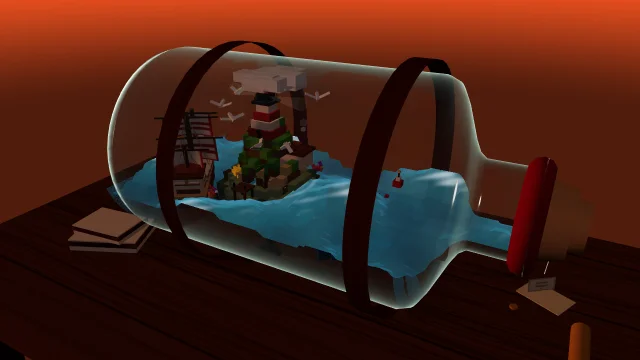</a> | ship-in-a-bottle | 玻璃瓶里的体素海洋，前进·梅利号四点浪高采样浮沉绕岛，四档天气、时刻滑杆与 Space 风暴，全部封闭在瓶内（Three.js r160 单 HTML） | [在线](https://fanhuayishiy.github.io/ai-demo/ship-in-a-bottle/) | [README](./ship-in-a-bottle/README.md) |

## 本地运行

优先使用上方“在线”链接体验。需要本地运行时，在目标项目 README 中查看对应命令：

- **静态项目**：在仓库根目录运行 `python -m http.server 8000`，再打开 `http://localhost:8000/` 选择项目。
- **已有构建产物**：同样通过静态服务打开该项目的 `dist/`（部分项目为 `dist/client/`）。
- **修改并开发项目**：进入项目目录，按其 README 安装依赖并启动；各项目的技术栈和启动命令并不相同。

完整发布副本的构建与检查见[维护文档](./docs/maintaining.md#预览页统一-github-入口与自动发布)。

## 项目速览

以下为简短介绍，完整功能、操作、资源与验证边界见各项目 README。

## habitat-interactive-home — 栖居 HABITAT 家庭 3D 空间

探索客厅、卧室、书房、餐厨与卫浴，点选设备控制灯光和家电，遮挡墙体自动淡出。基于原创示例户型，使用 React、Three.js 与 Vite。

[在线预览](https://fanhuayishiy.github.io/ai-demo/habitat-interactive-home/dist/) · [README（含主生成提示原文）](./habitat-interactive-home/README.md)

## orbit-heatpump-washer-dryer — ORBIT 热泵洗烘结构实验室

通过整机、分层爆炸、内部拆解和热泵循环四种视图，探索洗烘一体机的结构与管路。附渲染图及拆装动画，模型为概念示意。

[在线预览](https://fanhuayishiy.github.io/ai-demo/orbit-heatpump-washer-dryer/dist/) · [README（含主生成提示原文）](./orbit-heatpump-washer-dryer/README.md)

## boeing-787-digital-twin — AEROSTRUCT 波音 787-9 结构数字孪生大屏

以波音 787-9 为外形参考，支持爆炸拆解、客舱剖视、部件联动和数据导出。监测面板使用模拟数据，非官方 CAD 或实时遥测。

[在线预览](https://fanhuayishiy.github.io/ai-demo/boeing-787-digital-twin/dist/) · [README（含主生成提示原文）](./boeing-787-digital-twin/README.md)

## sunny-side-kindergarten — 小小晴天实时 3D 幼儿园

低多边形微缩幼儿园，虚拟儿童与老师按预设路径开展课堂、阅读和户外活动。支持区域聚焦、人物跟随、自动漫游与移动端操作。

[在线预览](https://fanhuayishiy.github.io/ai-demo/sunny-side-kindergarten/dist/) · [README（含主生成提示原文）](./sunny-side-kindergarten/README.md)

## hydrogen-energy-system — H₂ NEXUS 综合能源数字孪生

探索光伏、风电、制氢、储氢及燃料电池联动的三维能源园区。五色能流由本地守恒仿真驱动，运行资源随静态产物提供。

[在线预览](https://fanhuayishiy.github.io/ai-demo/hydrogen-energy-system/) · [README（含主生成提示原文）](./hydrogen-energy-system/README.md)

## campus-3d-dashboard — 智慧校园 3D 数据大屏

等距视角校园与数据看板，包含车辆循环、喷泉粒子、昼夜切换和双相机模式。单 HTML 项目，运行时依赖 CDN。

[在线预览](https://fanhuayishiy.github.io/ai-demo/campus-3d-dashboard/) · [README（含主生成提示原文）](./campus-3d-dashboard/README.md)

## mcb-2p-c16-blender-animation — 双极空气开关建模与工程动画

Blender 程序化建模的双极空气开关，提供工程动画、可编辑模型与渲染图。在线查看器支持旋转、章节跳转及进度拖动，内部机构为原理示意。

[在线交互展示](https://fanhuayishiy.github.io/ai-demo/mcb-2p-c16-blender-animation/) · [README（含主生成提示原文）](./mcb-2p-c16-blender-animation/README.md)

## voxel-construction-site — 体素微缩建筑工地沙盘「方寸之间」

挖掘机、渣土车、塔吊与工人在微缩工地协同作业，配有昼夜循环和模拟暴雨。Three.js 已内嵌，可离线运行；采样审计范围见项目文档。

[在线预览](https://fanhuayishiy.github.io/ai-demo/voxel-construction-site/preview.html) · [README（含主生成提示原文）](./voxel-construction-site/README.md)

## voxel-ramen-stall — 体素微缩深夜拉面摊沙盘

摊主、食客、外卖摩托与流浪猫组成微缩夜市，支持天色切换与模拟夜雨。使用确定性程序动画，碰撞与越界的采样验证见项目文档。

[在线预览](https://fanhuayishiy.github.io/ai-demo/voxel-ramen-stall/preview.html) · [README（含主生成提示原文）](./voxel-ramen-stall/README.md)

## sakura-station-corner — 樱花街角 · 电车与便利店微缩三维沙盘

电车、便利店、贩卖机与落樱组成微缩街角，支持五档天气及三渲二风格切换。几何与纹理在项目内生成，无运行时外部图片与 CDN。

[在线预览](https://fanhuayishiy.github.io/ai-demo/sakura-station-corner/dist/) · [README（含主生成提示原文）](./sakura-station-corner/README.md)

## sanfang-qixiang-atlas — 三坊七巷 · 坊巷漫游

基于 OpenStreetMap 街巷与建筑轮廓的三维古城导览，支持搜索、点击飞行、俯瞰和自动漫游。建筑高度与装饰为风格化复原。

[在线预览](https://fanhuayishiy.github.io/ai-demo/sanfang-qixiang-atlas/dist/) · [README（含主生成提示原文）](./sanfang-qixiang-atlas/README.md)

## terra-728-tractor-blender-animation — 现代四驱拖拉机建模与机械动画

虚构型号 TERRA 728 拖拉机的 Blender 模型与机械演示，展示转向、机罩、车门及悬挂等机构。提供可编辑模型、渲染图与交互查看器，参数为艺术调整。

[在线预览](https://fanhuayishiy.github.io/ai-demo/terra-728-tractor-blender-animation/) · [README（含主生成提示原文）](./terra-728-tractor-blender-animation/README.md)

## sunset-flight-study — 夕空飞行 · Just breathe

奶油白单翼机穿越紫金云海，支持电影航线、近距离驾驶与自由观察，配有官方流播音乐。提供原始请求及复现提示词；音乐权利不包含在代码的 MIT 许可中。

[在线预览](https://fanhuayishiy.github.io/ai-demo/sunset-flight-study/dist/) · [README（含主生成提示原文）](./sunset-flight-study/README.md) · [当前版本完整复现提示词](./sunset-flight-study/docs/RECREATE_PROMPT.zh-CN.md)

## warehouse-demo — WareTrack 仓储运营中心

三维仓储园区中，卡车、叉车与托盘完成循环搬运，库存、任务和月台面板共享状态。支持搜索、聚焦、暂停与镜头巡游，业务数据均为本地模拟。

[在线预览](https://fanhuayishiy.github.io/ai-demo/warehouse-demo/dist/client/) · [README](./warehouse-demo/README.md) · [当前项目完整复现提示词](./warehouse-demo/docs/RECREATE_PROMPT.zh-CN.md)

## modular-fire-response — FIRELINK 分布式智能消防

三机共用水带的分布式消防概念演示，包含移动增压、循环补水与重载无人机物资投送。运动与供水为前端概念示意，不用于实际救援决策。

[在线预览](https://fanhuayishiy.github.io/ai-demo/modular-fire-response/dist/) · [README](./modular-fire-response/README.md) · [当前项目完整复现提示词](./modular-fire-response/docs/RECREATE_PROMPT.zh-CN.md)

## roadster-escape-toll — Roadster 逃离收费站

驾驶搭载冷气推进器的 Roadster，在三条车道间平滑切换，长按点火飞越收费站，空中翻滚，完整飞越车辆按高度返还冷气。车速缓慢提升，提供失败建议、手机操作与本地排行榜；车模参考官方渲染图制作，项目可离线运行。

[在线预览](https://fanhuayishiy.github.io/ai-demo/roadster-escape-toll/) · [README（含主生成提示原文）](./roadster-escape-toll/README.md) · [官方渲染侧视叠加对比](./roadster-escape-toll/docs/official-render-compare.png)

## ocean-shallows — 浅海 · Ocean Shallows

俯视热带浅海，探索白沙、棕榈树、渐变海水、焦散与七种热带鱼，点击水面生成涟漪。几何与纹理程序化生成，并通过预烘焙减少每帧计算。

[在线预览](https://fanhuayishiy.github.io/ai-demo/ocean-shallows/) · [README（含主生成提示原文）](./ocean-shallows/README.md)

## ship-in-a-bottle — 瓶中沧海 · 前进·梅利号

横卧玻璃瓶里装着一整片体素海洋：前进·梅利号按四点浪高采样浮沉绕岛，灯塔光束扫过浪尖、鲸鱼周期性跃身出水、水底沉着宝箱与沉船遗物。晴/多云/雨/雾四档天气平滑过渡，时刻滑杆与黎明-正午-黄昏-子夜跳转驱动昼夜流转，按住 Space 掀起风暴——瓶体摇晃而水面保持水平。所有元素由瓶体 SDF 裁剪严格封闭在瓶内，任何视角不越轮廓。

[在线预览](https://fanhuayishiy.github.io/ai-demo/ship-in-a-bottle/) · [README（含主生成提示原文）](./ship-in-a-bottle/README.md)

---

## 新增项目

先阅读 [AGENTS.md](./AGENTS.md)，准备独立项目目录、项目 README 和实际运行截图，再使用 `npm run add:project` 追加到末尾。截图必须是 640×360 的静态 WebP，大于 1000 且小于 80000 字节。

[追加命令与参数](./docs/maintaining.md#用脚本追加推荐) · [部署与本地验证](./docs/maintaining.md#预览页统一-github-入口与自动发布) · [截图分享](./docs/maintaining.md#截图分享) · [访问量与隐私](./docs/maintaining.md#本页访问量与隐私)

发布前运行 `npm test` 和 `npm run build:pages`。CI 检查失败会停止部署；项目顺序、截图规范与统一预览入口必须保留。

---

代码采用 [MIT License](./LICENSE)；项目中的第三方素材与依赖以各自许可为准。友链：[LINUX DO 社区](https://linux.do/)。
