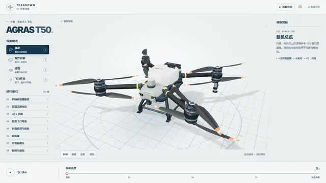

# DJI AGRAS T50 · 农业无人机 3D 拆解与飞行

从起飞点跟随 T50 完成一趟喷洒飞行，也可用左侧索引查看螺旋桨、药箱等八组部件的拆解细节。

[在线预览](https://fanhuayishiy.github.io/ai-demo/agras-t50-teardown/dist/) · [一键复现提示词](#一键复现提示词) · [返回项目合集](../README.md)



## 一键复现提示词

将下方整句复制到有文件编辑和浏览器预览能力的 AI 编程工具中即可使用。

```text
请在当前目录新建独立的 agras-t50-teardown 项目，用 elvarofficial/teardown（https://github.com/elvarofficial/teardown）和 Three.js 制作可离线运行的中文 DJI AGRAS T50 农业无人机 3D 拆解与飞行展台，以大疆官方产品图（https://ag.dji.com/t50）及使用手册 PDF 第 10、35 页（https://dl.djicdn.com/downloads/t50_t25/20250109/T50_T25_User_Manual_v1.0_EN.pdf）的整机、俯视和侧视图为外观依据，程序化建模四支碳纤维折叠机臂、四组同轴双层螺旋桨（共八副，同轴上下反向转动）、前排略宽后排略高的电机布局、带偏置旋盖的白色 40 L 药箱、DB1560 电池、中段上拱的双侧滑橇、后臂电机下的两只雾化喷头及前后雷达和双目镜窗，用倒角、碳纤维纹理、橙色桨尖、铰链、接缝、紧固件和软阴影塑造细节，用细网格和环形刻度衬托装配展台并为飞行安排田垄与 A／B 起降标记，将电机铜绕组、转轴与航电板建为可观察的示意结构，界面采用浅灰蓝底、深蓝字、细分隔线、等宽数字和少量橙色强调，桌面顶栏显示 TEARDOWN、拆解导览和 PNG 保存，左栏放 AGRAS T50 大标题、装配／爆炸拆解／透视／飞行作业四种模式及螺旋桨、电机、药箱、电池、机臂骨架、起落架、喷头、航电感知八组可点选部件，中间是可拖转缩放、切换斜视／俯视／正视并复位的三维视口，右栏联动显示部件说明、单独查看入口、当前飞行阶段及双喷头状态，底部通栏放播放／暂停／继续／重播和可拖动的时间线，飞行时可点选起飞、前进、撒药、降落四个阶段，拆解时用同一控制区的 0–100% 滑杆控制部件分批平滑移出和原路复装，满拆显示八组引线标注，透视时淡化外壳，三维拾取与左侧索引同步选中并可单独聚焦部件，支持带特写的自动拆解导览及 1／2／3、P、R、Esc 快捷键，首次进入自动播一遍 14.4 秒的 A 到 B 视觉演示，依次让八桨加速、机身垂直升起、机头微俯向前平移、后置双喷头向下及略向后释放可见的浅青雾粒、下降前收雾、在 B 点落地并逐步停桨，拖动旋转时暂停并根据系统减少动态效果偏好改为手动播放，手机将视口和通栏控件放在部件索引之前并支持触控旋转和双指缩放，提供可维护的源代码、构建说明和内嵌脚本样式字体及许可证的 dist/index.html，以 https://fanhuayishiy.github.io/ai-demo/agras-t50-teardown/dist/ 为效果对照并实际打开页面检查桌面与手机排版、整段飞行、拆解复装、透视、聚焦、PNG 导出和断网运行。
```

## 主生成提示（原文）

> 在当前目录下单独建一个当前的目录，使用teardown拆解一个无人机，要求精细化模型，让我之后打开页面时，能由衷地惊叹：“哇，太棒了！“

### 后续补充（原文）

> 你找一个大疆的农业无人来做模型，然后做起飞前进降落动作

> 为什么没有左侧的项目，没有按之前的项目要求来做吗？起飞之后做一下撒药动作

> 真实的T50是这个样子吗

> 面板参考图片美化一下

## 功能亮点

- **飞行演示**从 A 点启桨、垂直起飞，向前飞行时由后置双喷头显示浅青色雾粒，收雾后在 B 点落地停桨。底部可暂停、继续、重播、拖动 14.4 秒时间线或跳到四个动作。右侧显示当前阶段和喷头状态。启用系统「减少动态效果」时，点击「飞行演示」即可手动播放。
- **交互拆解**提供装配、爆炸拆解和透视。左栏部件索引和三维点击都能联动右栏说明，展开滑杆控制 0–100% 的拆解与复装，单独查看会把选中部件放大到画面中心。
- **观察操作**支持导览、斜视／俯视／正视、鼠标拖转和滚轮缩放，触屏可拖转和双指缩放。按 1／2／3 切换拆解模式，P 控制飞行，R 复位，Esc 暂停或退出特写。「保存画面」导出当前三维视图的 PNG。

## 技术栈

原生 JavaScript、CSS、Three.js 0.186.1 和 WebGL 2。无人机、场景与雾粒由程序生成，Teardown 提供运行与单文件构建。离线 HTML 内嵌样式、脚本、Inter 和 JetBrains Mono 字体及第三方许可文本。 [Teardown 源码](https://github.com/elvarofficial/teardown/tree/a91262ac1109051e014662d42ecb0b7bc1f113b1)

## 运行与构建

直接用支持 WebGL 2 的浏览器打开 [dist/index.html](./dist/index.html) 即可离线体验。重新构建时，在此项目目录使用 Node.js 22 或以上版本运行以下命令。

```sh
git clone https://github.com/elvarofficial/teardown.git .teardown
git -C .teardown checkout --detach a91262ac1109051e014662d42ecb0b7bc1f113b1
npm --prefix .teardown ci
npm run build
npm test
npm --prefix .teardown exec -- playwright install chromium
npm run test:browser
```

已有同一版本的 Teardown 时，可将 `TEARDOWN_DIR` 环境变量设为该检出目录的绝对路径。运行 `npm run test:browser -- --shots` 可将实测画面保存到本地 `screenshots/`。

## 目录结构

| 文件 | 用途 |
| --- | --- |
| `dist/index.html` | 可直接打开的离线页面 |
| `main.js`、`ui.js`、`style.css` | 交互状态、部件面板和响应式布局 |
| `model.js`、`airframe.js`、`systems.js`、`parts.js` | 整机装配、机身、子系统和部件索引 |
| `geometry.js`、`materials.js`、`stage.js` | 程序化几何、材质、相机和灯光 |
| `kinematics.mjs`、`mist.js` | 拆解、导览、飞行动作和喷洒效果 |
| `build.mjs`、`tests/` | 单文件构建、动作测试和浏览器验收 |

## 验证与边界

Node 测试检查飞行阶段顺序、喷雾启停、停桨、可复装的拆解轨迹和可逐帧采样的导览。Chromium 验证覆盖断网加载、桌面和触屏布局、飞行播放和拖动进度、透视、部件聚焦以及 PNG 导出。项目缩略图取自浏览器实拍。

外形参考官方公开图纸与照片，药箱和同轴旋翼等可见结构按喷洒配置建模。内部绕组和航电板为示意，飞行与喷洒均为网页动画。 [大疆 T50 产品图](https://ag.dji.com/t50) · [技术规格](https://ag.dji.com/t50/specs) · [整机图](https://dl.djicdn.com/downloads/t50_t25/20250109/T50_T25_User_Manual_v1.0_EN.pdf#page=10) · [俯视与侧视图](https://dl.djicdn.com/downloads/t50_t25/20250109/T50_T25_User_Manual_v1.0_EN.pdf#page=35)
