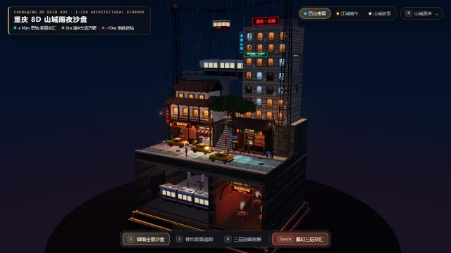

# 重庆 8D 山城雨夜微缩沙盘 · CHONGQING 8D RAIN BOX

1:150 博物馆级重庆 8D 山城立体剖面微缩沙盘：从地下穿山地铁与 1969 人防防空洞老火锅，到地面青石板梯坎、巴渝吊脚楼与黄色出租车，再到空中李子坝单轨穿楼与长江索道，支持三档气候、三层剖面拆解与程序化原声。

[在线预览](https://fanhuayishiy.github.io/ai-demo/chongqing-8d-rain-box/dist/) · [主生成提示（原文）](#主生成提示原文) · [返回项目合集](../README.md)



## 生成模型信息

- **AI 模型**：Gemini 4 Neon (High)
- **协作环境**：Antigravity IDE（全流程程序化建模、着色器与纹理生成、离线单文件打包与 Chromium 实景自检）

## 功能亮点

- **三层 8D 山城垂直剖面**：
  - **TIER +1（+14m 至 +18m）**：7 层马赛克居民楼（凸出式防盗网、空调外机、楼顶水箱、太阳能热水器与霓虹招牌）、三至五层镂空涵洞与「李子坝站 · LIZIBA」牌坊、4 节编组 2 号线跨座式单轨列车，以及凌空掠过屋脊的红白长江索道轿厢与钢桁架塔。
  - **TIER 0（0m 至 +7m）**：青苔砂岩堡坎、雨夜青石板梯坎、巴渝吊脚楼（吊脚立柱、美人靠、斗拱、3D 实例化小青瓦与飞檐翘角）、三间实景 3D 纵深暖光商铺（「重庆老火锅」「山城小面 · 冰粉」「山城茶馆」）、2,400+ GPU 实例化羽状枝叶黄桷树与落叶、3 辆渝A 黄色出租车、8 骨雨伞行人、电线杆与交错架空线、雨水篦子、井盖及外卖电瓶车。
  - **TIER -1（-10m）**：开放式黄铜边框地下剖面（已移除前侧玻璃），左侧为「洪崖雨巷站」穿山盾构地铁站台、黄盲道与 3 节流线型红银地铁列车，右侧为「★ 人防防空洞 · 1969 ★」红砖拱顶地下老火锅洞穴、爱迪生灯串、红灯笼与四桌沸腾九宫格火锅。
- **三种山城气候与交汇模式**：支持 `巴山夜雨`（GLSL 湿润水洼霓虹倒影与三层雨滴涟漪）、`江城晴午`（青瓷至杏色暖阳，自动收起雨伞）和 `山城初雪`（哑光小青瓦积雪、自动隐藏落叶、零过曝泛光）；按 `Space` 触发单轨、索道、出租车与地铁同步交汇。
- **三层剖面拆解与 CAD 标注**：按 `4` 沿发光标尺垂直拆解三层结构，自动投影 8 张中文 CAD 标注卡片并进行碰撞避让（零重叠、零越界）。
- **程序化山城原声**：按 `M` 开启 WebAudio 实时合成的瓦檐细雨、五声音阶古琴/毡音钢琴旋律、索道铜铃与地铁到站提示音。

## 技术栈

TypeScript、Three.js 0.172、Vite 6、`vite-plugin-singlefile`、WebGL 2 与 WebAudio API。全部几何体、Canvas2D 纹理、GLSL 着色器、离屏 PMREM 环境贴图和音效均在本地程序化生成，零外部网络请求与 CDN 依赖。

## 运行与构建

可直接使用浏览器打开离线构建产物 [dist/index.html](./dist/index.html) 或单文件版 [dist-wall/index.html](./dist-wall/index.html)。本地开发与重新构建需要 Node.js 22+：

```bash
npm install
npm run dev          # 本地开发预览
npm run build        # 标准静态构建 -> dist/
npm run build:wall   # 离线单文件构建 -> dist-wall/index.html
```

## 目录结构

| 文件 | 用途 |
| --- | --- |
| `dist/index.html`、`dist-wall/index.html` | 可直接运行的静态构建与离线单文件构建 |
| `src/main.ts` | Three.js 场景、选择性泛光后处理、相机预设、交互与自动化钩子 |
| `src/scene/plinth.ts` | 深胡桃木与拉丝黄铜展台、铭牌及三层拆解标尺 |
| `src/scene/tierSky.ts` | TIER +1：李子坝单轨穿楼、2 号线跨座式单轨与长江索道 |
| `src/scene/tierStreet.ts` | TIER 0：青石板梯坎、巴渝吊脚楼、实景商铺、黄桷树与雨夜街景 |
| `src/scene/tierSubway.ts` | TIER -1：穿山地铁洪崖雨巷站与 1969 防空洞地下老火锅剖面 |
| `src/textures.ts`、`src/shaders.ts` | 程序化 Canvas2D 纹理、湿润路面与雨滴涟漪 GLSL 着色器 |
| `src/weather.ts`、`src/audio.ts`、`src/callouts.ts` | 三档气候与粒子、WebAudio 山城原声、8 张 CAD 拆解标注布局 |

## 验证与边界

- 已在 Headless Chrome（`1440×810`）实测加载离线构建产物，覆盖雨夜全景、梯坎街景、地下剖面、江城晴午、山城初雪与三层剖面拆解 6 组视图：外部网络请求为 `0`，控制台错误与警告均为 `0`，拆解模式 8 张标注卡重叠数与越界数均为 `0`。
- 场景为 1:150 艺术微缩沙盘模型，融合李子坝、洪崖洞/十八梯、长江索道与重庆防空洞意象，不作为真实建筑工程测绘图纸。

## 主生成提示（原文）

```markdown
# CHONGQING 8D RAIN BOX // 重庆 8D 山城雨夜微缩沙盘

Build a museum-grade, standalone interactive 3D architectural cutaway diorama (**1:150 scale**) of **Chongqing's iconic 8D cyberpunk mountain city** mounted on a dark-walnut and brushed-brass exhibition plinth (`Three.js` + `TypeScript` + `Vite` + `vite-plugin-singlefile`, strictly offline single-file `dist-wall/index.html` with **0 external network requests** and **0 console errors/warnings**).

Work exclusively inside the current working directory. Initialize a clean Vite + TypeScript + Three.js + `vite-plugin-singlefile` project (`npm run build` and `npm run build:wall` producing `dist-wall/index.html`), build all geometry, shaders, textures, lighting, animation, HUD, and audio procedurally from scratch (zero external textures/models/fonts/CDNs), and self-verify your rendered output in real macOS headless Chrome (`--use-gl=angle --use-angle=metal`, `1440×810`) before finishing.

---

## 1. Three-Tier Vertical 8D Cutaway Architecture (Museum Micro-Craftsmanship Bar)

### TIER +1 (`+14m` to `+18m` · 李子坝单轨穿楼 & 长江索道)
- **Liziba Monorail Through Building (`李子坝单轨穿楼`)**:
  - Authentic 7-story Chongqing residential apartment tower with weathered cream/terracotta mosaic-tile facade, subtle rain-drip weathering beneath window sills & parapets, **3D protruding wrought-iron security window cages (`凸出式防盗网`)** with small potted plants and tiny colorful drying laundry hints, varied warm/cool apartment window interiors & curtain silhouettes, wall-mounted AC outdoor units, rooftop water tanks, solar heater, stair penthouse, and a subtle glowing red rooftop neon sign (`重庆 · 山城`) plus side vertical neon (`雾都山城`).
  - A clean hollow structural tunnel punched through mid-floors (`floors 3–5`) framed by an architectural concrete collar and illuminated `李子坝站 · LIZIBA` gantry sign, carrying an elevated concrete straddle-beam viaduct straight through the building with side maintenance catwalk railings and riveted pier bearings.
- **Chongqing CRT Line 2 Straddle Monorail (`重庆轨道2号线跨座式单轨`)**:
  - 4-car articulated straddle-beam monorail train (emerald-green / silver / white livery) with a sculpted aerodynamic front nose, wrap-around cockpit visor, glowing amber LED destination strip (`2号线 · 较场口`), warm headlights / red taillights, articulated dark accordion gangway bellows between cars, recessed illuminated passenger cabins showing seats & `扶手吊环` handstraps, and rubber-tire bogie skirts hugging the concrete beam — gliding continuously through the apartment tunnel with **zero wall clipping**.
- **Yangtze River Cableway (`长江索道`)**:
  - Iconic red-and-cream aerial tramway gondola cabin with wrap-around window frames, warm interior glow & miniature passengers/handrails, curved steel hanger arm & 4-wheel roller trolley gliding slowly along taut steel catenary cables strung between X-braced steel lattice pylons with red aviation beacons, cleanly separated above the rooftop silhouette.

### TIER 0 (`0m` to `+7m` · 洪崖洞/十八梯雨夜梯坎老街 & 巴渝吊脚楼)
- **Mountain-City Terracing & Authentic Bayu Diaojiaolou (`巴渝吊脚楼` + `青石板梯坎`)**:
  - Multi-level weathered sandstone retaining wall with damp moss stains (`青苔堡坎`), rain-slick **bluestone staircase (`青石板梯坎`)** climbing between street levels, and a multi-story Chongqing wooden stilted pavilion with dark-lacquered **cantilevered timber stilt columns (`吊脚立柱`), `穿斗` posts & diagonal braces, carved outward-canted `美人靠` balcony balustrades, overhanging `斗拱` eave brackets**, **3D instanced ribbed dark-grey Chinese small roof tiles (`小青瓦`)**, upturned curved eaves (`飞檐翘角`) + ridge finials, rain gutters & downspouts, and warm amber under-eave lighting.
- **Real 3D Recessed Warm Shop Interiors & Lived-In Micro-Props** (NEVER flat glowing rectangles):
  - **「重庆老火锅」**: Carved wooden lattice windows (`木雕花窗`) looking straight into a warm 3D interior (round wooden tables, glowing crimson nine-grid copper hotpots `九宫格`, wooden stools, wall menu `鲜毛肚·冰球鹅肠·嫩鸭血`, warm pendant lamps, subtle rising steam wisps), vertical `毛肚鸭肠` neon, crimson ribbed silk lanterns (`大红灯笼`) with gold tassels, stacked green `山城啤酒` plastic crates & bottles, and an illuminated sidewalk A-frame signboard.
  - **「山城小面 · 冰粉」**: Warm recessed alley noodle shop counter, striped awning, swaying multi-flap fabric doorway curtain (`门帘`), 3-tier steaming bamboo `蒸笼` & stockpot, red plastic stools around a folding sidewalk table.
  - **「山城茶馆」**: Vintage storefront with illuminated interior shelves stocked with colorful tea canisters, swaying `老茶馆` doorway curtain, and retro blue Chongqing enamel street nameplate (`十八梯 · 8D山城`).
- **Lush Weeping Chongqing Banyan Trees (`山城黄桷树`)**:
  - Sculpted gnarly dark-bark trunks and aerial roots clinging to the stone retaining wall, topped with **2,000+ GPU-instanced delicate alpha-cutout multi-leaf foliage clusters** (procedural botanical bouquet texture + subtle vertex breeze sway — **strictly ZERO chunky low-poly spheres/icosahedrons!**) + scattered wet fallen leaves along the bluestone steps & road gutters (auto-hidden in snow).
- **Sculpted Street Life, Vehicles & Wet Asphalt**:
  - **Yellow Chongqing Taxis (`重庆黄色“法拉利”出租车`)**: Smoothly sculpted beveled multi-section car bodies (curved hood & roof, dark front radiator grille, slanted windshield & rear glass with thin A/B/C pillars, wipers & side mirrors, visible interior seats/driver, flared wheel arches with 5-spoke silver alloy rims, crisp blue `渝A` license plates, glowing roof `出租 / TAXI` beacon, crimson taillight clusters, and soft Fresnel volumetric headlight cones).
  - **Articulated Miniature Pedestrians**: Proportioned silhouettes with coats, scarves, bags, shoes, and **8-ribbed translucent vinyl & colored umbrellas** with curved handles walking along the bluestone stairs and sidewalks.
  - **Dense Foreground Street Props**: Flush dark-iron storm-drain grates (`雨水篦子`), embossed cast-iron manhole covers, black-and-yellow roadside bollards & pedestrian guardrails, detailed utility poles with ceramic insulators, pole-mounted transformers & sagging tangled overhead utility wires crisscrossing the alley, red fire hydrant, and parked delivery e-scooters (`外卖电瓶车`) with yellow/blue insulated boxes.
  - **GLSL Wet Bluestone & Asphalt**: Multi-octave micro-grain bump, glossy tire-track wetness channels, rich shimmering crimson/amber/cyan neon puddle reflections across the crosswalk & steps, 3-layer concentric raindrop ripples, and soft Metal-safe Fresnel volumetric streetlamp/lantern halos.

### TIER -1 (`-10m` · 穿山盾构地铁站台 & 防空洞地下老火锅剖面)
- Framed by a **crystal-clear anti-reflective Fresnel acrylic cutaway panel** (`transmission: 0`, `transparent: true`, `depthWrite: false`, thin rim sheen) on a dark-walnut & brushed-brass exhibition plinth with engraved brass nameplate.
- **Deep Mountain Subway Station (`穿山地铁 · 洪崖雨巷站`)**:
  - Unobstructed cutaway sightline (tunnel arch ribs hug ONLY the back wall & ceiling, stopping cleanly at the top-front cutaway lip so they NEVER slice across the train or signage!).
  - Glazed ceramic tile walls with Chongqing Rail crimson/amber stripe, crisp calibrated Chinese signboards (`(渝) 洪崖雨巷站 · HONGYA YUXIANG STA.`, `← 2号线·李子坝`, `防空洞老街出口`), recessed ceiling louver light coves (well-calibrated, zero whiteout), yellow bumpy tactile paving (`盲道`), platform benches, and waiting commuters.
  - **Aerodynamic Red-and-Silver Chongqing Metro Train**: Smoothly curved beveled fiberglass cab nose, flush wrap-around panoramic windshield with wipers & glowing amber LED destination display (`洪崖雨巷 · 方向`), dual warm LED headlights + red markers, etched sliding-door seams, louvered rooftop HVAC pods, accordion bellows, recessed lit cabin interiors with seats & `扶手吊环` handstraps, and detailed underbody bogies/wheelsets smoothly gliding in and out.
- **Air-Raid Shelter Underground Hotpot Cave (`防空洞地下老火锅`)**:
  - Right-side cutaway showcasing Chongqing's iconic subterranean brick-and-stone vaulted shelter (`★ 人防防空洞 · 1969 ★` plaque + glowing `防空洞老火锅` signboard), warm brick-bump vaulted depth with arched masonry ribs, draped Edison festoon string lights, 4 glowing red `渝` silk lanterns, wall menu plaque, **4 wooden round tables with boiling crimson nine-grid copper hotpots, bowls/bottles, rising steam wisps, red stools & seated diners**, warmly lit so it glows invitingly even from the Hero `Key 1` angle, flanked by stratified sandstone bedrock & brass-flanged drainage conduits.

---

## 2. Interactive Controls, Three Climates & Explode CAD View
- **Top-left minimal museum header**: `CHONGQING 8D RAIN BOX · 1:150 ARCHITECTURAL DIORAMA` / `重庆 8D 山城雨夜沙盘` + live 3-tier status line (`+16m 单轨穿楼`, `0m 梯坎老街`, `-10m 穿山地铁`).
- **Top-right pills**: 3 Climates (`Key 3` / clickable):
  1. `巴山夜雨` (Rainy Neon Night — default)
  2. `江城晴午` (Warm Golden-Hour Mountain Sunlight — celadon-to-apricot sky & sunlit highlights)
  3. `山城初雪` (Cozy Lantern Snow Night — soft matte snow blankets on upturned `小青瓦` tiles, ledges & road, strictly **ZERO bloom whiteout**!)
  Plus `[M] 山城原声` WebAudio toggle.
- **Bottom control dock**:
  - `1 微缩全景沙盘` (3/4 museum hero framing showing ALL 3 vertical tiers cleanly with margin above bottom dock)
  - `2 梯坎街景追踪` (intimate 8D alley framing showing yellow taxis, `重庆老火锅` recessed interior, lanterns, bluestone stairs, weeping banyan, **and** the overhead Liziba monorail piercing the building in one signature frame)
  - `4 三层剖面拆解` (smooth vertical 3-tier explode along illuminated technical guide axes with **8 crisp Chinese CAD callout cards**, 4 left + 4 right, dynamic projection + vertical collision avoidance guaranteeing **0 card overlaps, 0 HUD overlaps, and 0 out-of-bounds**)
  - `Space 魔幻三层交汇` (triggers synchronized peak 8D convergence of Monorail + Cableway + Yellow Taxis + Subterranean Metro)

---

## 3. Warm Organic Soundscape (`src/audio.ts`)
- Interactive WebAudio soundscape unlocked on click / `[M]`: cozy filtered rain-on-tiles ambient bed + gentle warm Chinese pentatonic guqin/felt-piano hybrid melody + soft distant monorail glide hum + warm bronze cableway bell + gentle subway arrival chime (`RMS ~0.12–0.15`, `Peak <= 0.85`, strictly warm and pleasant — zero harsh hiss or eerie synthetic sweeps).

---

## 4. Chrome Metal Safety & Deterministic Automation Hooks (REQUIRED)
- **Chrome Metal ANGLE WebGL Safety**:
  - NEVER combine `MeshPhysicalMaterial` `transmission > 0` with MSAA `EffectComposer` (`HalfFloatType`) — use `transmission: 0` Fresnel acrylic glass.
  - Guard all GLSL `pow(max(x, 1e-5), y)` and divisions against `NaN`/`Inf` poisoning `UnrealBloomPass`.
  - Selective bloom threshold `>= 0.90`, well-calibrated emissive luminance across all 3 weather modes.
  - Zero external CDN fonts/images/scripts — use clean local Chinese system font stacks and Canvas2D textures.
- **Deterministic Hooks on `window`** (used for automated QA & 60fps cinema capture):
  - `window.__setDioramaState(opts)`: accepts `{ view?: 'hero' | 'street' | 'explode', weather?: 'rain' | 'sun' | 'snow', exploded?: boolean, convergence?: boolean, time?: number, autoOrbit?: boolean }` and snaps smoothly/deterministically when requested.
  - `window.__advanceSimulation(dt)`: advances all animations (trains, cableway, taxis, rain/snow, ripples, steam, lanterns, camera lerp) deterministically by `dt` seconds and renders a frame.
  - `window.__setCameraPose(pos: [number, number, number], target: [number, number, number])`: places camera/controls deterministically.
  - `window.__getDioramaMetrics()`: returns `{ fps, triangles, drawCalls, weather, view, exploded, convergence, calloutCount, calloutOverlaps, calloutOutOfBounds }`.

Build, visually verify in headless Chrome Metal (capture & inspect screenshots across Rain Hero, Key 2 Alley Close-Up, Subway + Cave Cutaway, Sunny Day, Winter Snow, and Key 4 Explode), fix any visual/geometry/bloom/overlap imperfections you spot, and make sure `dist-wall/index.html` is cleanly rebuilt and verified at the end.
```

### 后续补充（原文）

> 去掉地下室的玻璃
