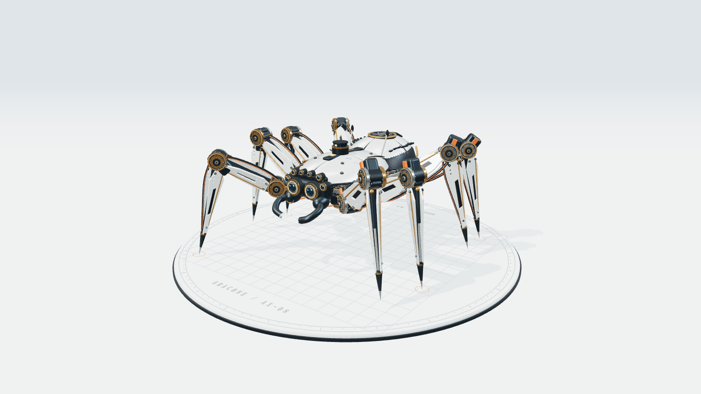

# 机器人蜘蛛 · 八足拆解实验室

一个可在浏览器中交互的八足机器人拆解展示。使用 Three.js 与 `elvarofficial/teardown` 构建；完整预览打包在 `dist/index.html`，双击即可打开，无需安装依赖或联网加载模型。

## 项目介绍与模型提示词

本项目把机器人蜘蛛做成一座可探索的机械拆解实验室：先观察八足步态，再展开机身外壳，查看控制板、电源和运动关节，或单独检修一条腿。下面的提示词整理自本次需求，便于了解设计目标或复用来制作相似项目；它是整理稿，不是逐字还原的单条原始输入。

> 参考 `https://github.com/elvarofficial/teardown` 的 Three.js 交互式拆解展示方式，制作一个精细、有质感、可在浏览器中交互的八足机器人蜘蛛拆解实验室。设计一台具有未来工业感的机械蜘蛛：机身由分瓣装甲、镜头阵列、螯肢、主控板与后置电源模块组成；八条腿具有清晰的髋、股、胫三级结构，加入关节轴承、护甲、连接线束和细节紧固件。腿的末端必须是细长、明确尖锐的金属尖足，尖端随胫节正确转动并落在计算出的步态足端位置，不能做成圆钝脚掌。展示协调的交替步态，并提供装配视图、爆炸拆解、单腿检修、透视查看、视角切换和部件说明。使用精致的材质、灯光、阴影与克制的技术界面，让模型打开时具有强烈的视觉完成度；页面需适配桌面和手机，支持离线运行。

[在线预览](https://fanhuayishiy.github.io/ai-demo/spider-teardown/dist/) · [返回项目合集](../README.md)



## 主生成提示（原文）

https://github.com/elvarofficial/teardown，使用他这个拆解一个机器人蜘蛛

### 后续精细化要求（原文）

精细化蜘蛛模型，当前模型太简单了，调整一下，我改完之后打开页面时，能由衷地惊叹：“哇，太棒了！

### 后续结构修正（原文）

蜘蛛的腿应该是尖的

## 功能亮点

- 可旋转、缩放的八足蜘蛛三维视图，展示交替步态与 24 个运动关节。
- 提供装配总览、爆炸拆解、单腿检修、透视外壳、足端轨迹和自动导览。
- 机身包含分瓣外壳、八枚独立镜头、螯肢、控制板、电源和电池组件。
- 镂空腿甲、碳纤维骨架、齿盘、连接线与末端尖足均由模型几何构成；尖足跟随胫节转动，并落在步态计算出的足端位置。
- 支持调节步频和机身高度、切换视角、暂停动画与保存模型截图。

## 技术栈

Three.js、WebGL、程序化几何、逆运动学与交替四足步态；构建框架来自 [teardown](https://github.com/elvarofficial/teardown)。静态预览内嵌脚本、样式、字体和授权文本。

## 运行方式

直接打开 `dist/index.html`。也可在本项目目录运行任意静态文件服务器，并访问 `/dist/`。完整页面不依赖第三方 CDN。

## 目录结构

```text
spider-teardown/
  README.md
  preview-canvas.png  实际运行画面
  dist/index.html    可独立运行的完整页面
```

## 验证与边界

本地验证包含 5 项运动学检查、4 项模型几何与装配检查、浏览器交互检查，以及对尖足的 768 个姿态检查。检查覆盖桌面交互、离线启动和手机布局。

这是一个概念展示模型。动作使用逆运动学和预设步态，不模拟刚体动力学、真实地形碰撞或机器人电气性能；外观尺寸也不代表特定商品型号。
