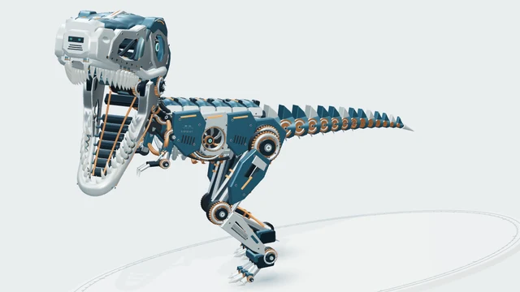

# TYRANT RX-01 · 机械霸王龙拆解档案

[在线试玩](https://fanhuayishiy.github.io/ai-demo/tyrant-rex/dist/) · [下载离线 HTML](https://raw.githubusercontent.com/fanhuayishiy/ai-demo/main/tyrant-rex/dist/index.html) · [返回项目合集](../README.md)

## 项目介绍与模型提示词

TYRANT RX-01 是一台用程序化几何建模的机械霸王龙。它沿检修台交替迈步，停稳后转头张嘴怒吼，再掉头往返。两侧眼皮会遮住光学镜片，胸甲的检视窗能看到连续旋转的飞轮。

> 复现提示词（根据下方原文整理）：用 teardown 和 Three.js 制作可独立运行的机械霸王龙拆解页面。细化有镂空颅骨、上下牙列、液压下颌和可眨动眼皮的头部，让胸甲检视窗露出持续旋转的心脏飞轮。让霸王龙沿检修台走一段、停稳、转头张嘴怒吼，声音与下颌同步，然后掉头继续走。提供装配总览、爆炸拆解、装甲透视和部件特写，将模型、字体与音效打包成离线 HTML。

## 主生成提示（原文）

> 在当前目录下单独建一个当前的目录，使用teardown拆解一个机器霸王龙，要求精细化模型，让我之后打开页面时，能由衷地惊叹：“哇，太棒了！“

### 后续调整（原文）

> 当前建模太简单了，再精细化一些，比如头部等

> 心脏那边的轮子，让它持续转动起来，让人有一种心脏在运行的感觉。转动的时候漏出来一块，可以让外面看到它里面在转动。

> 动作改一下，当前的动作不像霸王龙，不够威武。要让它吼起来，张开嘴巴。

> 霸王龙的动作改成张嘴怒吼，顺便带上声音。它是转头怒吼。

> 动作是走一段，然后转头怒吼，这样循环。

> 继续，恐龙的眼睛加一个眼皮，并且会眨眼。

## 体验方式

- 浏览器里双击打开 `dist/index.html` 即可离线游玩。若浏览器拦截自动播放，点击三维视图右上角的 **转头怒吼** 开启有声重播，顶部扬声器可静音。
- 拖动旋转、滚轮缩放。点击部件可放大查看颅骨、核心、装甲、后肢和尾部。
- 用拆解滑块展开模型，或切换透视查看胸腔与控制结构。可调节动作速度、暂停、自动导览和导出截图。

## 修改源码

`kinematics.mjs` 求解步态和关节姿态，`model.js` 与 `cranial.js` 生成装配模型，`sound.js` 用 Web Audio 合成吼声。构建依赖 [teardown](https://github.com/elvarofficial/teardown) 和 Node.js 20+。

将 `tyrant-rex/` 复制到开发目录，在同一级准备 `teardown/`。使用版本 `a91262ac1109051e014662d42ecb0b7bc1f113b1`，在 `teardown/` 执行 `npm ci`。然后在 `tyrant-rex/` 执行 `npm run build`，重新生成 `dist/index.html`。运行 `npm test` 可检查步态与模型。浏览器验证需先在 `teardown/` 安装 Playwright Chromium，再在项目目录运行 `npm run test:browser`。

这是概念展示。步态使用逆运动学与预设落点，验证涵盖支撑足、眼皮遮挡、关节连接和离线浏览器交互。依赖授权与建模参考见 [第三方来源](./THIRD_PARTY_NOTICES.md)。
